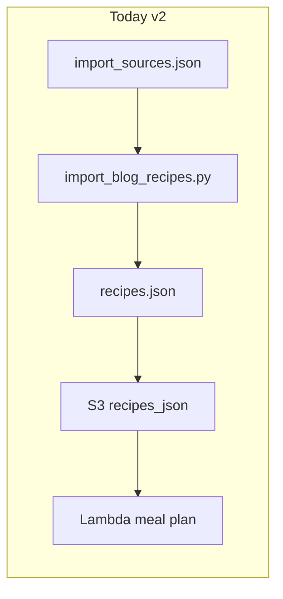
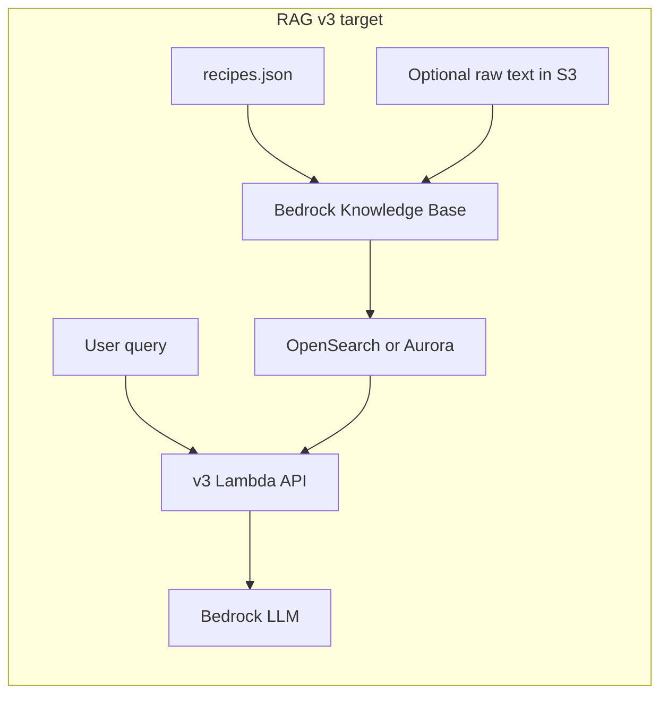

# PantryBuddy RAG (v3): Enhancements and Knowledge Base

## Locked decisions (asked before finalizing this plan)

| Topic | Choice |
|-------|--------|
| **Stack** | **AWS-native**: Bedrock Knowledge Bases with a supported vector store (e.g. OpenSearch Serverless or Aurora pgvector) and embeddings via Bedrock (e.g. Titan). |
| **Content** | **Structured first**, then an **optional second corpus** of raw page text/HTML for narrative not in `recipes.json`. |
| **Entry point** | **REST API in Lambda**: retrieve → prompt LLM (Bedrock InvokeModel or compatible pattern), prioritized for **local testing**; not Bedrock Agent as the primary v3 surface. |

The existing [`infrastructure/lib/bedrock-agent-stack.ts`](infrastructure/lib/bedrock-agent-stack.ts) dietician agent remains **out of scope** for the primary v3 path unless you later attach the same KB for a separate conversational UX.

---

## Current baseline (what v3 builds on)

- **Sources**: Curated URLs in [`data/recipes_json/import_sources.json`](data/recipes_json/import_sources.json) with `mealType`, `diet`, `cuisine`, `sourceName`.
- **Ingestion (offline)**: [`tools/import_blog_recipes.py`](tools/import_blog_recipes.py) fetches pages, parses JSON-LD / HTML, and merges into the canonical artifact [`data/recipes_json/recipes.json`](data/recipes_json/recipes.json) (see [`data/recipes_json/recipes.schema.json`](data/recipes_json/recipes.schema.json)).
- **Runtime (v2)**: [`backend/lambda_function.py`](backend/lambda_function.py) loads JSON from S3 (or local disk) and generates plans—**no embeddings, no semantic retrieval** (design doc already mentions future “retrieval boundaries” in [`docs/HIGH_LEVEL_DESIGN_v2.md`](docs/HIGH_LEVEL_DESIGN_v2.md)).

---

## Knowledge base shape (aligned with your choices)

### Corpus A — Structured (primary)

Turn each canonical recipe into retrieval document(s): title + ingredients + instructions + **metadata** (`mealType`, `diet`, `cuisine`, `sourceName`, stable `id`) + **source URL** for citations. This is the default retrieval target for grounded answers.

### Corpus B — Raw narrative (secondary)

Optional **separate** KB or data source (or separate index in the same KB with a `docType` metadata filter): chunked cleaned text from fetched pages for tips/story content not in the JSON. Expect **more noise**; use **after** structured retrieval or with explicit user intent (“what does the blog say about substitutions?”).

---

## Enhancements required for RAG v3

### 1. Ingestion / indexing pipeline (new)

- **Document builders**: (A) deterministic text from `recipes.json`; (B) optional HTML→text cleanup + chunking for raw pages (may require extending the importer to persist raw text to S3 for KB sync).
- **Embeddings**: Bedrock embedding model (e.g. Titan) in the KB pipeline; batch on deploy or scheduled job.
- **Bedrock Knowledge Base**: Configure S3 (or custom) data sources, chunking strategy, and sync to the chosen vector store (OpenSearch Serverless vs Aurora per AWS constraints and cost).
- **Sync strategy**: Re-sync when `recipes.json` or raw artifacts change (full refresh acceptable at current scale).

### 2. Retrieval strategy (new)

- **Hybrid**: metadata filters (`mealType`, `diet`, …) **plus** semantic search on user text.
- Optionally **query Corpus A first**; fall through or blend with Corpus B when the question is narrative-heavy.
- **Top-k + MMR** (optional) to diversify near-duplicate recipes.

### 3. LLM orchestration in Lambda (new)

- **Flow**: `Retrieve` (Bedrock Knowledge Bases API) → assemble context with citations → `InvokeModel` (e.g. Claude on Bedrock) with a system prompt that **only** uses retrieved content for factual recipe claims.
- **Guardrails**: low/no results → honest “not in catalog” response.

### 4. API and product surface (v3)

- New route(s), e.g. `POST /v3/...` (chat, “suggest meals”, “explain recipe”), separate from v2 deterministic planner.
- **Versioning**: [`backend/config.py`](backend/config.py) `API_ENDPOINTS`; [`frontend/src/config.js`](frontend/src/config.js) when the UI calls v3.

### 5. Infrastructure and ops

- **CDK**: Knowledge Base, data bucket/prefix(es), vector store, IAM for Lambda (`bedrock:Retrieve`, `bedrock:InvokeModel`, KB resource ARNs).
- **Local dev**: pattern using `RECIPE_DATA_SOURCE=local` and either mocked retrieval or **conditional** Bedrock calls with dev credentials (document in adapter notes).
- **Cost/latency**: document indexing offline; per-request query embedding + retrieve + one LLM call.

### 6. Compliance and quality

- **Attribution**: always return `sourceUrl` / `sourceName` from structured metadata when citing recipes.
- **Evaluation**: small golden query set for recall and citation accuracy.

### 7. Documentation

- Add v3 / RAG section to design docs when implementation starts (not part of this plan’s execution).

---

## Optional later: Bedrock Agent

The standalone agent stack can be wired to the **same** Knowledge Base later for a chat-first UX without changing the retrieval corpus; keep Lambda v3 as the integration-tested core.
