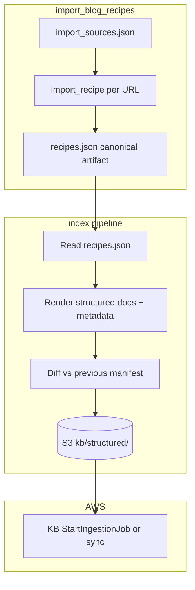
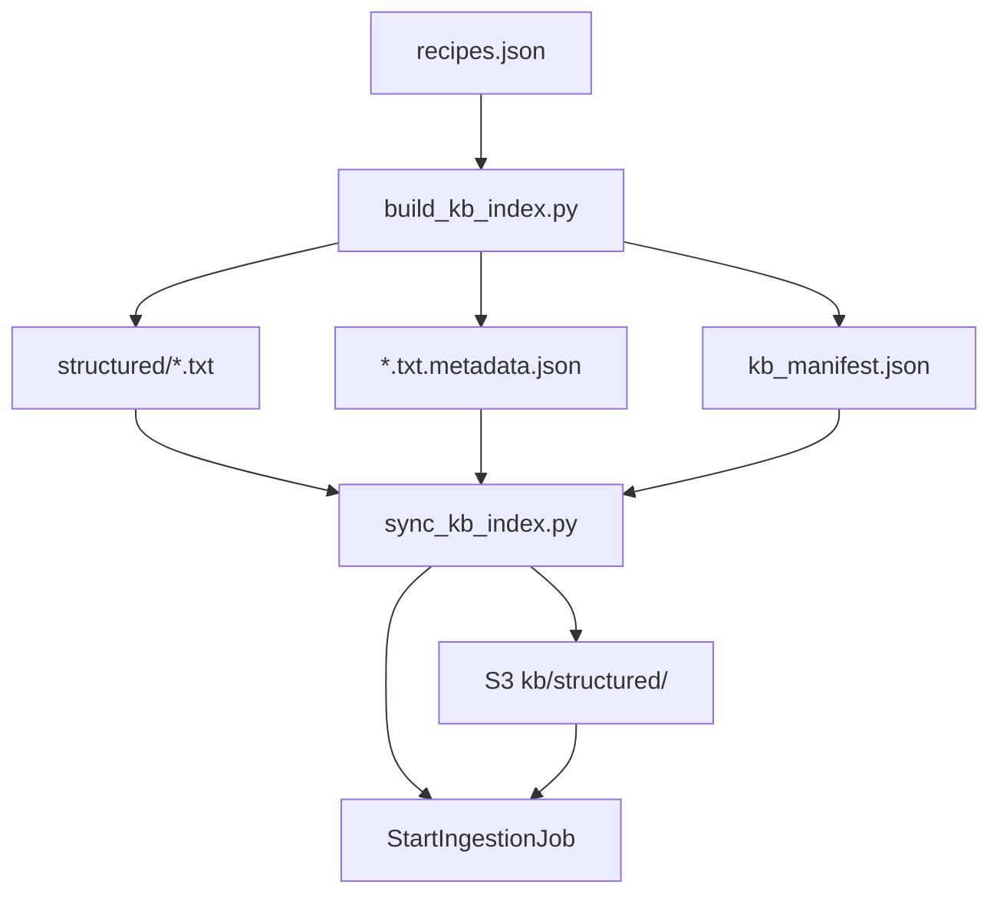

# RAG v3: Index pipeline design

**Status:** Structured corpus builder, S3 sync CLI, CDK Knowledge Base, Lambda Retrieve/InvokeModel wiring, and golden query/citation eval implemented; Corpus B remains pending  
**Scope:** Recipe-to-chunk mapping for Bedrock Knowledge Bases, metadata for hybrid retrieval, and rebuild/upsert workflow driven by `import_blog_recipes.py` output.

Stack choices (embedding model, KB, vector store) live in [`HIGH_LEVEL_DESIGN_v2.md`](HIGH_LEVEL_DESIGN_v2.md) §2.3.

---

## 1. Upstream artifact: what the importer produces

[`tools/import_blog_recipes.py`](../tools/import_blog_recipes.py) is the primary offline path from curated sources to the canonical dataset.

| Output | Description |
|--------|-------------|
| **Canonical artifact** | JSON written to `--output` (default `data/recipes_json/recipes.json`): wrapper with `version`, `generatedAt`, `sourceType`, and `recipes[]`. |
| **Each recipe** | Must match [`data/recipes_json/recipes.schema.json`](../data/recipes_json/recipes.schema.json): `id`, `title`, `sourceUrl`, `sourceName`, `mealType`, `diet`, `cuisine`, `ingredients[]`, `instructions[]`, `nutrition`, `image`. |
| **Stable id** | `id` = `build_recipe_id(title, sourceUrl)` (slug from title, optionally suffixed by last path segment when needed for uniqueness). |
| **Merge** | With `--merge-existing`, `merge_recipes()` **upserts** by identity keys `(id, value)` and `(sourceUrl, value)` so the same logical URL or id updates in place. |
| **Indexes** | Optional `--write-indexes` emits `breakfast.json` … `dinner.json` beside the artifact; these are for v2 selection, not required for KB indexing. |

The index pipeline **reads the canonical artifact after a successful import** (and optionally a separate raw-text store once that exists). It does not replace the importer.

---

## 2. Corpus A — Structured recipe documents

**Goal:** One retrieval-friendly text representation per recipe (or a small fixed split), with metadata that mirrors the JSON for filters and citations.

### 2.1 Chunking strategy

| Approach | When to use |
|----------|-------------|
| **Single document per recipe (default)** | Emit one UTF-8 text object per `recipes[i]`. Bedrock KB applies its configured chunking; semantic search still works across the body. Prefer this for v3 until scale or embedding limits force splitting. |
| **Split only when oversized** | If the rendered body exceeds a chosen byte/token budget (implementation-defined), emit multiple parts: `…-part01.txt`, `…-part02.txt` with identical metadata except `chunkPart` / `chunkIndex`. |

**Deterministic body template (conceptual):**

1. **Header block** — `title`, then lines for `mealType`, `diet`, `cuisine`, `sourceName`, `sourceUrl` (always include URL for human-readable citations in retrieved snippets).
2. **Ingredients** — bullet lines from `item`, `amount`, `unit`, `preparation` (same order as JSON).
3. **Instructions** — numbered steps from `step` + `text`.
4. **Optional footer** — short nutrition line if any nutrition field is non-null.

Rendering must be **stable** (fixed field order and separators) so two runs with the same JSON produce the same bytes (helps content hashing).

### 2.2 Logical ↔ storage mapping

| Concept | Value |
|---------|--------|
| **Logical key** | Canonical `recipe.id` (slug). |
| **S3 object key (example)** | `kb/structured/{recipe_id}.txt` (or `.md` if you prefer; plain text is enough). |
| **Multi-part** | `kb/structured/{recipe_id}-p{nn}.txt` with `nn` zero-padded. |

---

## 3. Corpus B — Raw narrative (optional)

**Goal:** Capture blog narrative (tips, substitutions, story) that is **not** fully represented in `recipes.json`.

**Today:** `import_blog_recipes.py` fetches HTML in memory and does not persist full cleaned page text to disk or S3.

**Intended extension (separate change):** During import, write cleaned plain text (or stripped HTML) per fetched URL, e.g. `raw_pages/{sha256(normalized_sourceUrl)}.txt`, alongside a small manifest `{ sourceUrl, recipeId?, fetchedAt }` when the page maps 1:1 to an imported recipe.

| Aspect | Recommendation |
|--------|----------------|
| **Chunking** | Paragraph- or heading-based chunks with moderate overlap; separate KB data source or same bucket prefix `kb/raw/` with `docType=raw`. |
| **Linking** | Metadata `sourceUrl` (required); `recipeId` when the raw page is the same URL as the structured recipe’s `sourceUrl`. |
| **Retrieval order** | Structured corpus first; raw corpus for follow-up or narrative-heavy queries (per product plan). |

---

## 4. Metadata fields (for hybrid retrieval)

These fields should be available to the **retrieval** path (Bedrock KB metadata filtering + citation assembly). Exact wiring depends on KB configuration (e.g. S3 metadata files per object, or custom transforms).

### 4.1 Required / strongly recommended

| Field | Type | Source | Notes |
|-------|------|--------|--------|
| `docType` | `structured` \| `raw` | Pipeline | Separates corpora. |
| `recipeId` | string | `recipes[].id` | Omitted or empty for raw-only pages without a matched recipe. |
| `sourceUrl` | string | `recipes[].sourceUrl` or fetch URL | **Citation anchor**; required whenever URL exists. |
| `sourceName` | string \| null | `recipes[].sourceName` | Attribution. |
| `title` | string | `recipes[].title` | For display and keyword overlap. |
| `mealType` | enum | `recipes[].mealType` | `breakfast` \| `lunch` \| `snack` \| `dinner`. |
| `diet` | string \| null | `recipes[].diet` | Filter / display. |
| `cuisine` | string \| null | `recipes[].cuisine` | Filter / display. |

### 4.2 Pipeline / ops

| Field | Type | Notes |
|-------|------|--------|
| `artifactGeneratedAt` | ISO-8601 | Copy of canonical `generatedAt` when the structured doc was built. |
| `artifactVersion` | string | Copy of canonical `version` (e.g. `1.0`). |
| `contentSha256` | string (hex) | Hash of the indexed body bytes for **change detection** and manifests. |

### 4.3 Optional (multi-chunk)

| Field | Type | Notes |
|-------|------|--------|
| `chunkPart` | int | 1-based part index when split. |
| `chunkPartsTotal` | int | Total parts for the same `recipeId`. |

---

## 5. Rebuild vs upsert workflow

Bedrock Knowledge Bases over S3 typically use **sync jobs** rather than vector-level upserts. Treat **S3 as source of truth**: upsert means **put or delete objects**, then **start a sync** (full sync is acceptable at current scale).



### 5.1 Steps

1. **Import** — Run `import_blog_recipes.py` (with or without `--merge-existing`) until `recipes.json` is correct.
2. **Build** — Read `recipes.json`, emit one structured object per recipe (and optional raw objects if that store exists).
3. **Manifest diff** — Keep a **previous** `kb_manifest.json` (checked in or written by CI) listing `{ recipeId, contentSha256, sourceUrl }` per structured object. After build:
   - **Upsert:** PUT new or changed keys (hash differs or new id).
   - **Delete:** REMOVE S3 objects whose `recipeId` no longer appears in the current artifact (removals, or identity changes — see §6).
4. **Sync** — Trigger KB ingestion/sync for the structured prefix (full sync acceptable).
5. **Record** — Write new `kb_manifest.json` from the current artifact.

This is **rebuild-friendly**: deleting all `kb/structured/*` and re-uploading from scratch + full sync is a valid fallback when diff logic is skipped.

### 5.2 Relationship to importer merge semantics

Importer upsert uses `recipe_identity_keys`: **`id` and `sourceUrl`**. The index pipeline should key **structured documents** on **`recipe.id`**. If a human edits the canonical title such that `build_recipe_id` produces a **new** id for the same URL, the importer may replace the row keyed by `sourceUrl`, but the **old id** might disappear from the artifact — the manifest diff must **delete** the orphaned `structured/{old_id}.txt` object.

---

## 6. Edge cases

| Case | Handling |
|------|----------|
| **Recipe with `sourceUrl: null` (manual seed)** | Still index structured text; metadata `sourceUrl` empty; citations rely on `sourceName` / `title`. |
| **Duplicate titles, different URLs** | `build_recipe_id` may add a path suffix; ids remain unique — separate S3 keys. |
| **Failed import for a URL** | No recipe row — no structured doc; optional raw text should not claim a `recipeId` unless matched. |
| **Raw corpus without importer change** | Re-index raw only when raw blobs or chunking rules change; structured path unchanged. |

---

## 7. Local builder CLI

[`tools/build_kb_index.py`](../tools/build_kb_index.py) implements Corpus A (structured documents) on disk.

```bash
python3 tools/build_kb_index.py \
  --input data/recipes_json/recipes.json \
  --output-dir data/kb
```

Or `make build-kb-index`.

| Output | Path |
|--------|------|
| Structured body | `data/kb/structured/{recipe_id}.txt` (or `{recipe_id}-pNN.txt` when split) |
| Bedrock sidecar | `data/kb/structured/{filename}.txt.metadata.json` |
| Manifest | `data/kb/kb_manifest.json` |

`--rebuild` wipes `structured/` first. Without it, objects whose `recipeId` left the artifact are deleted locally (orphan cleanup). `--max-body-bytes` defaults to 40,000; typical recipes stay one file.

Generated `structured/` files and the manifest are gitignored; rebuild them after import.

### 7.1 Upload and Knowledge Base sync

CDK (`RecipeKnowledgeBase` in [`infrastructure/lib/knowledge-base.ts`](../infrastructure/lib/knowledge-base.ts)) provisions:

- OpenSearch Serverless vector collection + FAISS index (1024-d for Titan Text Embeddings V2)
- Bedrock Knowledge Base + S3 data source on `kb/structured/` (chunking `NONE`)
- `KbSyncRole` for upload + `StartIngestionJob`

**Region note:** Titan Text Embeddings V2 (`amazon.titan-embed-text-v2:0`) is supported for Knowledge Bases in **us-east-2**. Enable model access in the Bedrock console before the first ingestion.

Operational sync (manifest diff upsert; full sync with `--full`):

```bash
make build-kb-index
make sync-kb-index \
  DATA_BUCKET=<DataBucketName> \
  KNOWLEDGE_BASE_ID=<KnowledgeBaseId> \
  DATA_SOURCE_ID=<KnowledgeBaseDataSourceId>
```

Or `python3 tools/sync_kb_index.py --bucket ... --knowledge-base-id ... --data-source-id ...`.

`DeployKbStructured` also copies `data/kb/structured/` on CDK deploy (`prune: false`). Prefer the sync CLI after content changes so ingestion starts immediately.



## 8. Query / citation evaluation

Small golden set: [`data/kb/golden_queries.json`](../data/kb/golden_queries.json). Automated checks: [`tests/test_rag_eval.py`](../tests/test_rag_eval.py) (local lexical retriever + citation assembly; no AWS required).

| Check | Pass criteria |
|-------|----------------|
| **Recall** | For each non–low-recall case, every `mustIncludeRecipeIds` entry appears in top-`k` (and at `rankAtMost` when set). |
| **Filter hygiene** | `mustExcludeRecipeIds` never appear when metadata filters are applied. |
| **Low recall** | Nonsense queries return no chunks; chat answers with `LOW_RECALL_ANSWER` and empty `citations`. |
| **Citation fields** | Each citation includes `sourceUrl`, `sourceName`, `excerpt`, and `recipeId` when corpus A. |
| **Attribution fidelity** | Citation `sourceUrl` / `sourceName` match the catalog row for that `recipeId`. |
| **Dedup** | Duplicate retrieved chunks for the same `(recipeId, sourceUrl)` emit one citation. |

**Manual / prod checklist** (after KB sync):

1. Run `python3 -m unittest tests.test_rag_eval -v` against the current `recipes.json`.
2. Spot-check 2–3 golden queries via `POST /v3/chat` with `KNOWLEDGE_BASE_ID` set; confirm the expected `recipeId` is cited and URLs match the catalog.
3. Confirm a nonsense query returns the low-recall message with no invented sources.
4. When adding recipes or changing retrieval, extend `golden_queries.json` before merging.

## 9. Implementation checklist (forward reference)

- [x] Implement a small **builder** CLI or target under `tools/` that reads `recipes.json` and writes S3-local layout + `kb_manifest.json`.
- [x] CDK: KB data source pointing at the structured prefix; IAM for sync/deploy; S3 upload + ingestion CLI.
- [ ] Extend **import** (when ready) to persist **raw** cleaned text for Corpus B.
- [x] Lambda v3: wire `KNOWLEDGE_BASE_ID` + `bedrock:Retrieve` / `bedrock:InvokeModel` IAM, 60s/512MB, metadata filters + citations.
- [x] Golden query / citation eval (`data/kb/golden_queries.json` + `tests/test_rag_eval.py`).

This document is the contract for **index-pipeline** design; code should follow it unless product requirements change.
